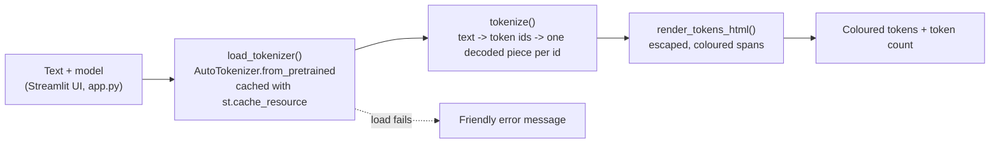

# LLM Token Visualizer

[](https://github.com/kishorhange111/llm-token-visualizer/actions/workflows/ci.yml)


**See your text the way an LLM does: a Streamlit app that splits the same text with eight different tokenizers, colours every token, and counts them, so you can compare models side by side.**

## Supported tokenizers
| Model | Hugging Face id | Tokenizer type |
|---|---|---|
| BERT | `bert-base-cased` | WordPiece |
| GPT-2 | `gpt2` | byte-level BPE |
| GPT-4 | `Xenova/gpt-4` | BPE (cl100k_base) |
| Flan-T5 | `google/flan-t5-small` | SentencePiece (Unigram) |
| StarCoder2 | `bigcode/starcoder2-15b` | BPE for code |
| Phi-3 | `microsoft/Phi-3-mini-4k-instruct` | SentencePiece BPE |
| Qwen2-VL | `Qwen/Qwen2-VL-7B-Instruct` | byte-level BPE |
| DeepSeek-R1 | `deepseek-ai/DeepSeek-R1-0528` | byte-level BPE |

Only the tokenizer files are downloaded (a few MB each), never the model weights.

## Why it matters
Tokenization decides an LLM's **cost** (APIs bill per token), how much fits in the **context window**, and some of its **behaviour** (e.g. why models struggle to count letters or do arithmetic on long numbers). This app makes those differences visible:
- BERT's **WordPiece** (`play ##ing`) vs. GPT-2's **byte-level BPE** (`Ġplaying`)
- how code-focused tokenizers (StarCoder2) handle indentation and symbols
- how many tokens the same sentence costs in each model — often very different for non-English text

## How it works

1. `AutoTokenizer.from_pretrained()` loads the selected tokenizer; `@st.cache_resource` keeps it in memory, so switching back is instant.
2. The text is encoded to token ids; each id is decoded back to its text piece.
3. Pieces are rendered as coloured HTML spans with the total token count; tokenizers that fail to load show a friendly error instead of crashing the app.

## Quickstart
```bash
git clone https://github.com/kishorhange111/llm-token-visualizer.git
cd llm-token-visualizer
pip install -r requirements.txt
streamlit run app.py          # or: make run
```
Deploys as-is to **Streamlit Community Cloud** (main file: `app.py`).

## Project layout
```
llm-token-visualizer/
├── app.py                  # Streamlit UI only
├── token_visualizer/       # tested logic
│   └── core.py             #   MODELS list, tokenize(), render_tokens_html()
├── tests/                  # pytest: core logic + Streamlit AppTest smoke tests
├── pyproject.toml          # metadata, ruff + pytest config
├── requirements.txt        # streamlit, transformers (pinned)
├── requirements-dev.txt    # pytest, ruff
└── Makefile                # make run / lint / test / check
```

## Testing
```bash
pip install -r requirements.txt -r requirements-dev.txt
make check                  # = ruff check . && pytest
```
Unit tests cover tokenization order, special-token counting, colour cycling, HTML escaping of token text, and that every model in the dropdown is documented. Smoke tests drive the real `app.py` with Streamlit's `AppTest` and a fake tokenizer patched in for `AutoTokenizer.from_pretrained`, covering the happy path, a tokenizer that fails to load, and empty input. Nothing is downloaded, so the suite runs offline. CI runs it on every push and pull request.

## Limitations
- **Needs the Hugging Face Hub at runtime.** The first use of each tokenizer downloads its files; offline, the app shows the load error.
- **Per-token decoding of byte-level BPE.** One character can span several byte-level tokens (common for emoji and non-Latin scripts); decoding those tokens one at a time can show a replacement character (`�`) instead of a partial character.
- **Leading-space markers depend on the tokenizer.** `decode()` turns GPT-2's `Ġ` back into a space, so some tokenizers show word boundaries and others don't.
- **No side-by-side view yet.** Models are compared one at a time.

## Tech stack
Python · Streamlit · Hugging Face Transformers (`AutoTokenizer`) · pytest · ruff · GitHub Actions
